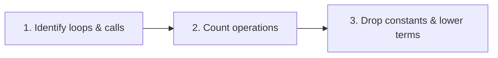
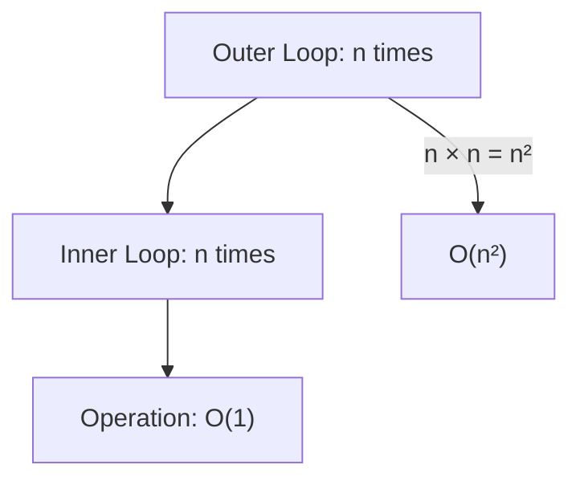
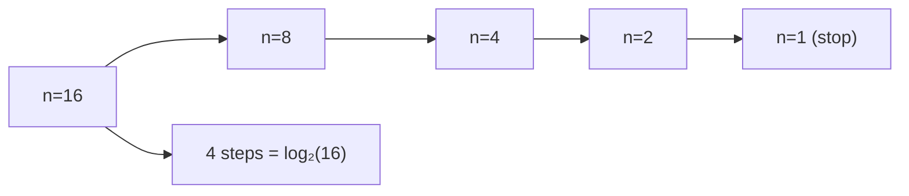

# Analyzing Code Complexity

---

## 1. The 3-Step Process



---

## 2. Rule 1 — Single Loop = O(n)

```python
for i in range(n):       # n iterations
    print(i)             # O(1) each
# Total: O(n)
```

---

## 3. Rule 2 — Nested Loops = Multiply

```python
for i in range(n):       # n
    for j in range(n):   # × n
        print(i, j)
# Total: O(n × n) = O(n²)
```



---

## 4. Rule 3 — Sequential Blocks = Add, Then Drop Lower

```python
for i in range(n):       # O(n)
    print(i)

for j in range(n):       # O(n)
    for k in range(n):   # O(n²)
        print(j, k)

# Total: O(n) + O(n²) = O(n²)  ← keep dominant term only
```

---

## 5. Rule 4 — Drop Constants

```python
for i in range(5 * n):   # O(5n) → O(n)
    print(i)

for i in range(n):       # O(n)
    print(i * 2)         # Constant work per step → O(n)
```

---

## 6. Rule 5 — Halving = Logarithmic

```python
i = n
while i > 1:
    i = i // 2    # Halved each iteration
# Runs log₂(n) times → O(log n)
```



---

## 7. Rule 6 — Recursive Calls = Recurrence

```python
def merge_sort(arr):
    if len(arr) <= 1: return arr
    mid = len(arr) // 2
    left = merge_sort(arr[:mid])    # T(n/2)
    right = merge_sort(arr[mid:])   # T(n/2)
    return merge(left, right)       # O(n)
# Recurrence: T(n) = 2T(n/2) + O(n) → O(n log n)
```

---

## 8. Practice: What is the Complexity?

```python
# Example A
for i in range(n):
    for j in range(10):   # constant!
        print(i, j)
# Answer: O(n × 10) = O(n)

# Example B
i = 1
while i < n:
    i *= 3    # Tripled each step → log₃(n) → O(log n)
```

---

## 9. Quick Reference Cheat Sheet

| Code Pattern | Complexity |
|---|---|
| `x = arr[0]` | O(1) |
| Single `for i in range(n)` | O(n) |
| Nested `for i ... for j` (both n) | O(n²) |
| `while i > 1: i //= 2` | O(log n) |
| Merge sort, Heap sort | O(n log n) |
| Fibonacci (naive recursion) | O(2ⁿ) |
