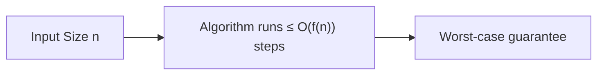
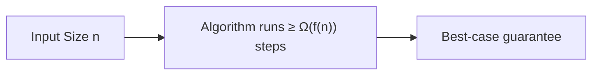
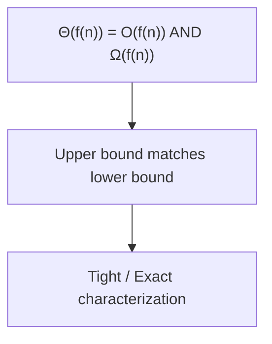
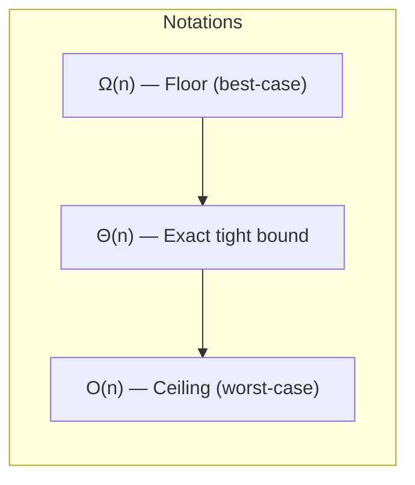
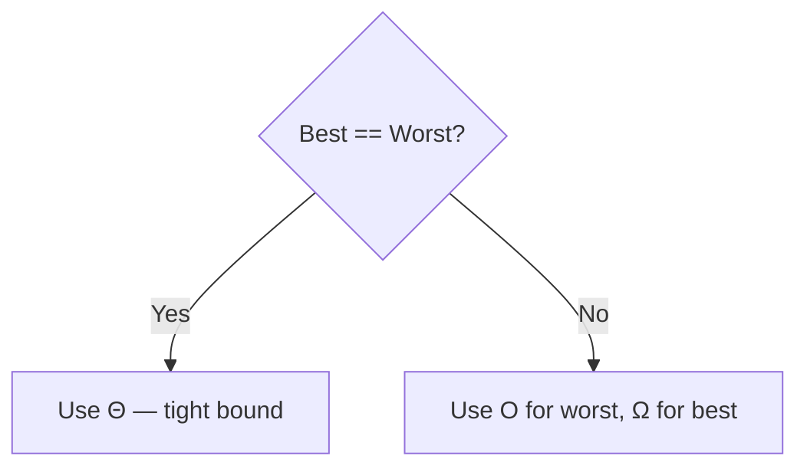

# Big-Omega and Big-Theta Notations

---

## 1. Quick Recap of Big-O

**Big-O (O)** — upper bound. Worst-case ceiling on growth.



---

## 2. Big-Omega: Lower Bound

**Ω(f(n))** says the algorithm takes **at least** f(n) steps. It describes the **best-case** floor.

> "No matter how lucky we get, it will cost at least this much."



### Example: Linear Search

- **Best case:** Element is first → `Ω(1)`
- **Worst case:** Element is last → `O(n)`

```python
def linear_search(arr, target):
    for i, val in enumerate(arr):
        if val == target:
            return i   # Ω(1) if found at index 0
    return -1          # O(n) if not found
```

---

## 3. Big-Theta: Tight Bound

**Θ(f(n))** means the algorithm is **both** O(f(n)) and Ω(f(n)).  
Best-case and worst-case grow at the same rate.

> "It always costs exactly this much (up to constants)."



### Example: Sum of Array

```python
def total(arr):
    s = 0
    for x in arr:    # Always n iterations, no early exit
        s += x
    return s
# Always Θ(n) — best and worst case are identical
```

---

## 4. Visual Comparison



| Notation | Meaning | Bound Type |
|---|---|---|
| **O(f(n))** | Grows no faster than f(n) | Upper bound |
| **Ω(f(n))** | Grows no slower than f(n) | Lower bound |
| **Θ(f(n))** | Grows exactly like f(n) | Tight bound |

---

## 5. Real-World Analogy

| Notation | Delivery Analogy |
|---|---|
| **O** | "Package arrives in at most 7 days" |
| **Ω** | "Package arrives in at least 1 day" |
| **Θ** | "Package always arrives in exactly 3 days" |

---

## 6. Key Rules



- If Θ(f(n)) exists, it's the most informative notation.
- Bubble Sort: `O(n²)` worst, `Ω(n)` best → **no Θ exists** for general case.
- Merge Sort: always `Θ(n log n)` → Θ exists.
