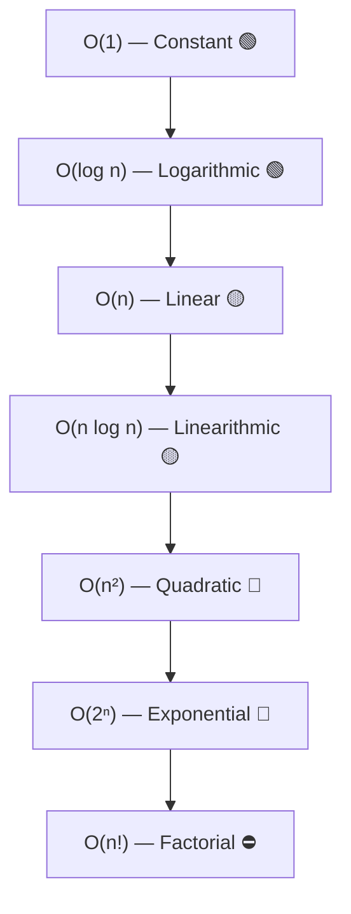
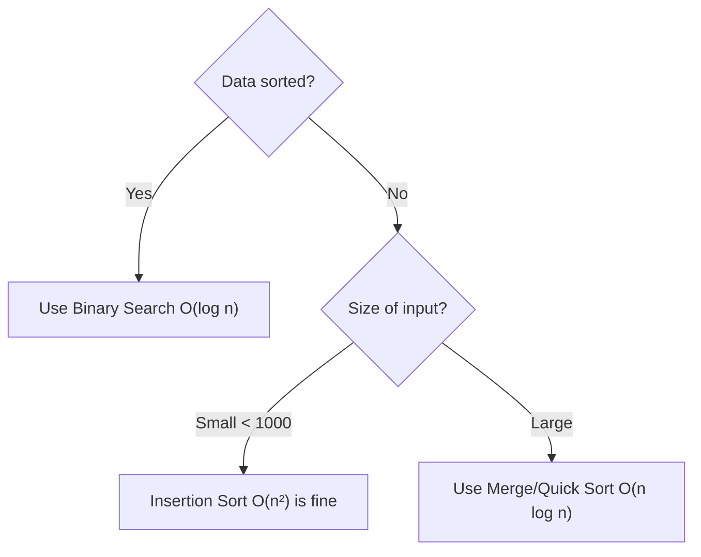

# Common Time Complexities

---

## 1. The Complexity Ladder



---

## 2. Each Complexity Explained

### O(1) — Constant Time
Operation count doesn't change regardless of input size.

```python
def get_first(arr):
    return arr[0]   # Always 1 step
```

---

### O(log n) — Logarithmic Time
Input is halved each step. Doubles in input → only 1 extra step.

```python
def binary_search(arr, target):
    lo, hi = 0, len(arr) - 1
    while lo <= hi:
        mid = (lo + hi) // 2
        if arr[mid] == target: return mid
        elif arr[mid] < target: lo = mid + 1
        else: hi = mid - 1
    return -1
```

---

### O(n) — Linear Time
One pass through the data.

```python
def find_max(arr):
    return max(arr)   # Visits every element once
```

---

### O(n log n) — Linearithmic Time
Divide-and-conquer algorithms. Optimal for comparison-based sorting.

```python
sorted_arr = sorted(arr)   # Python's Timsort: O(n log n)
```

---

### O(n²) — Quadratic Time
Nested loops each running n times.

```python
def bubble_sort(arr):
    for i in range(len(arr)):
        for j in range(len(arr) - i - 1):   # n × n
            if arr[j] > arr[j+1]:
                arr[j], arr[j+1] = arr[j+1], arr[j]
```

---

### O(2ⁿ) — Exponential Time
Every step doubles the work. Brute-force recursion.

```python
def fib(n):
    if n <= 1: return n
    return fib(n-1) + fib(n-2)   # Recomputes subproblems
```

---

### O(n!) — Factorial Time
Every permutation is enumerated. Only for tiny inputs.

```python
from itertools import permutations
all_routes = list(permutations(cities))   # Travelling Salesman brute force
```

---

## 3. Comparison Table

| Complexity | n=10 | n=100 | n=1000 | Example |
|---|---|---|---|---|
| O(1) | 1 | 1 | 1 | Array index access |
| O(log n) | 3 | 7 | 10 | Binary search |
| O(n) | 10 | 100 | 1,000 | Linear scan |
| O(n log n) | 33 | 664 | 9,966 | Merge sort |
| O(n²) | 100 | 10,000 | 1,000,000 | Bubble sort |
| O(2ⁿ) | 1,024 | 10³⁰ | ♾️ | Subset enumeration |
| O(n!) | 3.6M | ♾️ | ♾️ | Brute-force TSP |

---

## 4. Choosing the Right Algorithm


