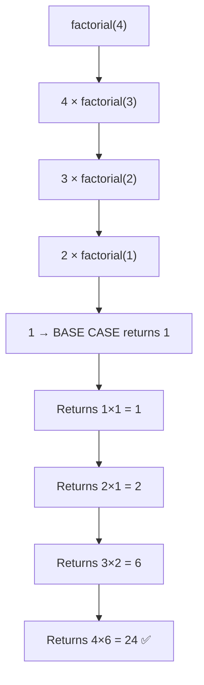
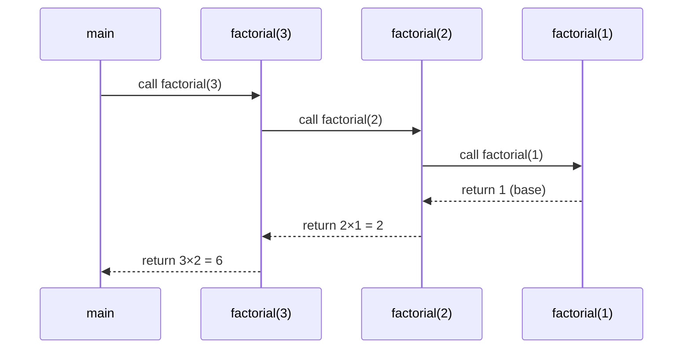
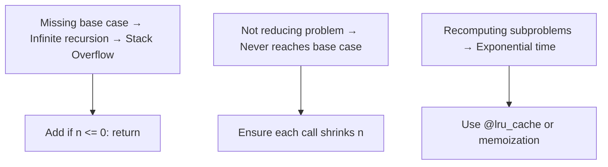

# Recursion

---

## 1. What is Recursion?

A function that **calls itself** with a smaller version of the same problem until it hits a **base case**.



---

## 2. The 2 Laws of Recursion

1. **Must have a base case** — the stopping condition.
2. **Must move toward the base case** — each call reduces the problem.

```python
def factorial(n):
    # Base case
    if n == 0 or n == 1:
        return 1
    # Recursive case — moves toward base (n decreases)
    return n * factorial(n - 1)

print(factorial(5))   # 120
```

**Output:**

```text
120
```

---

## 3. The Call Stack

Each call creates a **stack frame**. Frames stack up → then unwind on return.



---

## 4. Classic Examples

### Sum of List

```python
def sum_list(arr):
    if not arr:              # Base case: empty list
        return 0
    return arr[0] + sum_list(arr[1:])   # Shrinks list each call

print(sum_list([1, 2, 3, 4]))   # 10
```

### Fibonacci (Naive)

```python
def fib(n):
    if n <= 1: return n                 # Base cases
    return fib(n-1) + fib(n-2)         # Two recursive branches

print(fib(6))   # 8
```

---

## 5. Recursion vs Iteration

| Feature | Recursion | Iteration |
|---|---|---|
| **Readability** | Often cleaner for tree/graph problems | Cleaner for simple loops |
| **Memory** | O(n) stack frames | O(1) extra space |
| **Risk** | Stack overflow on deep input | No stack overflow risk |
| **Best for** | Trees, divide-and-conquer, backtracking | Linear scans, simple accumulation |

---

## 6. Tail Recursion

The recursive call is the **last** operation — some compilers optimize this to avoid extra stack frames.

```python
def factorial_tail(n, accumulator=1):
    if n == 0: return accumulator
    return factorial_tail(n - 1, n * accumulator)   # Last op = recursive call

print(factorial_tail(5))   # 120
```

---

## 7. Avoiding Redundant Work — Memoization

```python
from functools import lru_cache

@lru_cache(maxsize=None)
def fib_memo(n):
    if n <= 1: return n
    return fib_memo(n-1) + fib_memo(n-2)

print(fib_memo(40))   # Very fast — O(n) time and space
```

---

## 8. Common Recursion Pitfalls


