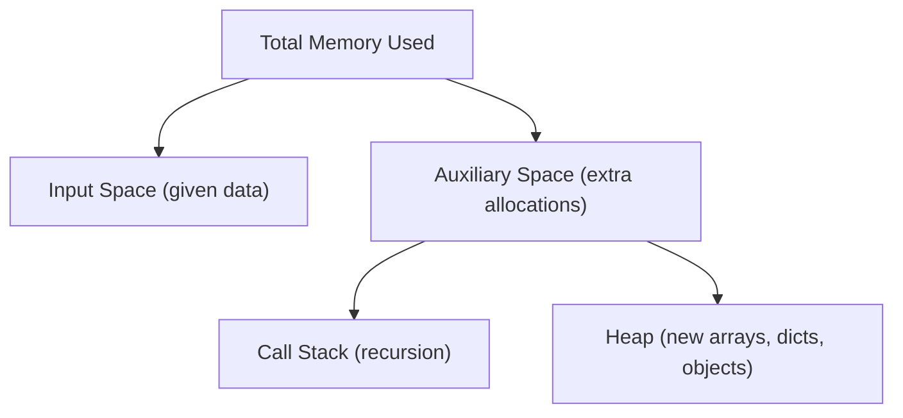
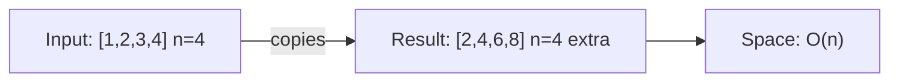
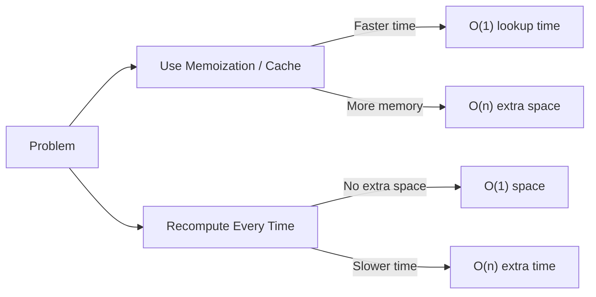

# Space Complexity

---

## 1. What is Space Complexity?

**Space complexity** measures how much **memory** an algorithm uses as a function of input size.

It includes:
- **Input space** — memory for the input data itself
- **Auxiliary space** — extra memory the algorithm allocates beyond the input

> In interviews, "space complexity" usually means **auxiliary space only**.

---

## 2. Memory Categories



---

## 3. O(1) — Constant Space

No extra memory allocated regardless of input size.

```python
def find_max(arr):
    maximum = arr[0]           # 1 variable
    for x in arr:
        if x > maximum:
            maximum = x        # 1 variable (reused)
    return maximum
# Space: O(1) — only 1 extra variable used
```

---

## 4. O(n) — Linear Space

Extra memory grows proportionally with input.

```python
def double_all(arr):
    result = []              # New list of size n
    for x in arr:
        result.append(x * 2)
    return result
# Space: O(n) — allocates n extra elements
```



---

## 5. O(log n) — Logarithmic Space (Recursion Stack)

Recursive algorithms use stack frames. Each call frame stays alive until it returns.

```python
def binary_search(arr, lo, hi, target):
    if lo > hi: return -1
    mid = (lo + hi) // 2
    if arr[mid] == target: return mid
    elif arr[mid] < target:
        return binary_search(arr, mid+1, hi, target)   # 1 frame added
    else:
        return binary_search(arr, lo, mid-1, target)   # 1 frame added
# Max depth = log n → Space: O(log n)
```

---

## 6. O(n) — Linear Space from Recursion

```python
def reverse(arr, i=0):
    if i >= len(arr) // 2: return
    arr[i], arr[-(i+1)] = arr[-(i+1)], arr[i]
    reverse(arr, i + 1)   # n/2 frames on call stack → O(n)
```

---

## 7. O(n²) — Quadratic Space

Storing a 2D grid or matrix.

```python
def create_matrix(n):
    return [[0] * n for _ in range(n)]   # n × n cells → O(n²)
```

---

## 8. Time vs Space Trade-Off



```python
# Trade time for space — memoization
cache = {}
def fib(n):
    if n in cache: return cache[n]      # O(n) space
    if n <= 1: return n
    cache[n] = fib(n-1) + fib(n-2)     # O(n) time
    return cache[n]
```

---

## 9. Quick Reference

| Algorithm | Time | Auxiliary Space |
|---|---|---|
| Linear search | O(n) | O(1) |
| Binary search (iterative) | O(log n) | O(1) |
| Binary search (recursive) | O(log n) | O(log n) |
| Merge sort | O(n log n) | O(n) |
| Quick sort (average) | O(n log n) | O(log n) |
| Bubble/Insertion sort | O(n²) | O(1) |
