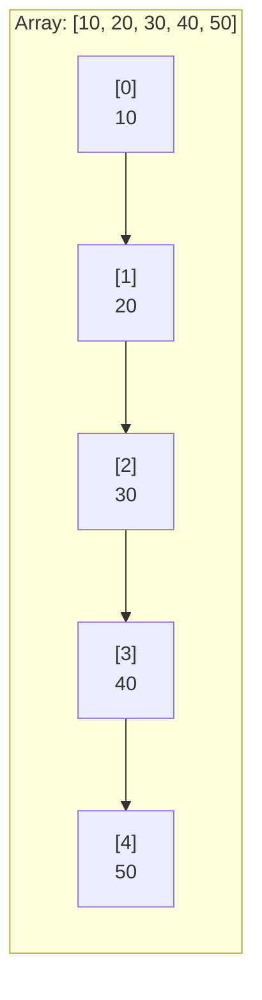
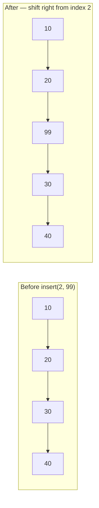
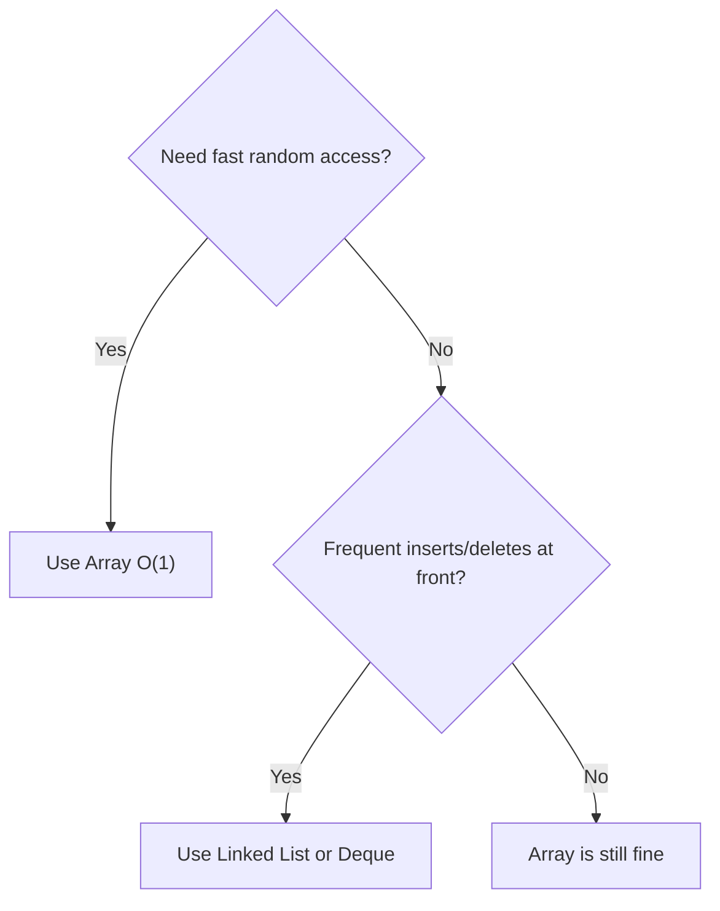

# Arrays

---

## 1. What is an Array?

An **array** is a contiguous block of memory storing elements of the same type, accessible by index in O(1) time.



---

## 2. Creating and Accessing Arrays

```python
# Python list acts as a dynamic array
arr = [10, 20, 30, 40, 50]

# Access by index — O(1)
print(arr[0])    # 10
print(arr[-1])   # 50  (last element)

# Slicing
print(arr[1:4])  # [20, 30, 40]
```

**Output:**

```text
10
50
[20, 30, 40]
```

---

## 3. Common Operations & Complexity

| Operation | Method | Time | Notes |
|---|---|---|---|
| Access by index | `arr[i]` | O(1) | Direct memory offset |
| Search (unsorted) | `in` / loop | O(n) | Must scan all |
| Insert at end | `arr.append(x)` | O(1) amortized | Occasional resize |
| Insert at middle | `arr.insert(i, x)` | O(n) | Shifts elements right |
| Delete from end | `arr.pop()` | O(1) | No shifting needed |
| Delete from middle | `arr.pop(i)` | O(n) | Shifts elements left |

---

## 4. Insertion at Middle — Why O(n)?



---

## 5. Traversal Patterns

```python
arr = [3, 1, 4, 1, 5, 9]

# Forward traversal
for x in arr:
    print(x, end=" ")   # 3 1 4 1 5 9

# With index
for i, val in enumerate(arr):
    print(f"[{i}]={val}", end=" ")

# Two-pointer pattern
left, right = 0, len(arr) - 1
while left < right:
    arr[left], arr[right] = arr[right], arr[left]
    left += 1
    right -= 1
print(arr)   # [9, 5, 1, 4, 1, 3]  (reversed)
```

---

## 6. 2D Arrays (Matrices)

```python
matrix = [
    [1, 2, 3],
    [4, 5, 6],
    [7, 8, 9],
]

# Access element at row 1, col 2
print(matrix[1][2])   # 6

# Traverse all elements
for row in matrix:
    for val in row:
        print(val, end=" ")
```

---

## 7. When to Use Arrays



---

## 8. Summary

| Property | Value |
|---|---|
| **Index access** | O(1) |
| **Search** | O(n) unsorted, O(log n) sorted |
| **Append** | O(1) amortized |
| **Insert/Delete middle** | O(n) |
| **Memory** | Contiguous — cache friendly |
