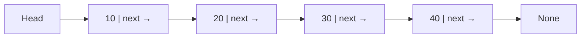
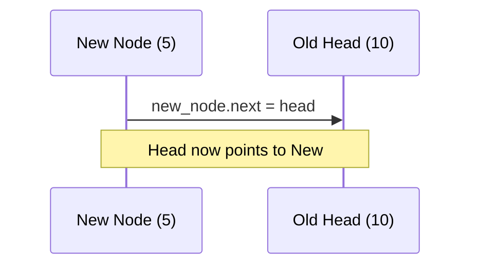
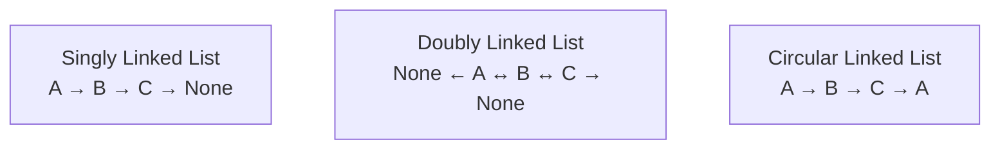
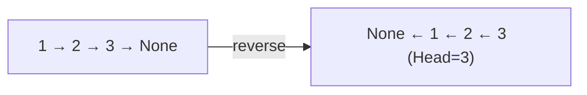

# Linked List

---

## 1. What is a Linked List?

A **linked list** is a chain of **nodes**, where each node holds a value and a pointer to the next node. Unlike arrays, elements are NOT stored contiguously in memory.



---

## 2. Node Structure

```python
class Node:
    def __init__(self, data):
        self.data = data
        self.next = None   # Pointer to next node
```

---

## 3. Building a Linked List

```python
class LinkedList:
    def __init__(self):
        self.head = None

    def append(self, data):
        new_node = Node(data)
        if not self.head:
            self.head = new_node
            return
        current = self.head
        while current.next:          # Walk to last node
            current = current.next
        current.next = new_node      # Link new node at end

    def display(self):
        vals = []
        current = self.head
        while current:
            vals.append(str(current.data))
            current = current.next
        print(" → ".join(vals))

ll = LinkedList()
ll.append(10)
ll.append(20)
ll.append(30)
ll.display()   # 10 → 20 → 30
```

---

## 4. Insertion at Head — O(1)



```python
def prepend(self, data):
    new_node = Node(data)
    new_node.next = self.head   # Point to current head
    self.head = new_node        # New node becomes head
```

---

## 5. Deletion by Value — O(n)

```python
def delete(self, target):
    if not self.head: return
    if self.head.data == target:
        self.head = self.head.next   # Remove head
        return
    current = self.head
    while current.next:
        if current.next.data == target:
            current.next = current.next.next   # Skip target node
            return
        current = current.next
```

---

## 6. Types of Linked Lists



---

## 7. Array vs Linked List

| Operation | Array | Linked List |
|---|---|---|
| **Access by index** | O(1) | O(n) — must traverse |
| **Insert at head** | O(n) — shift all | O(1) — just relink |
| **Insert at tail** | O(1) amortized | O(n) or O(1) with tail ptr |
| **Delete middle** | O(n) — shift all | O(n) — traverse to find |
| **Memory** | Contiguous | Scattered (extra pointer overhead) |

---

## 8. Reverse a Linked List (Classic Interview)



```python
def reverse(self):
    prev, current = None, self.head
    while current:
        nxt = current.next    # Save next
        current.next = prev   # Reverse pointer
        prev = current        # Move prev forward
        current = nxt         # Move current forward
    self.head = prev
```
