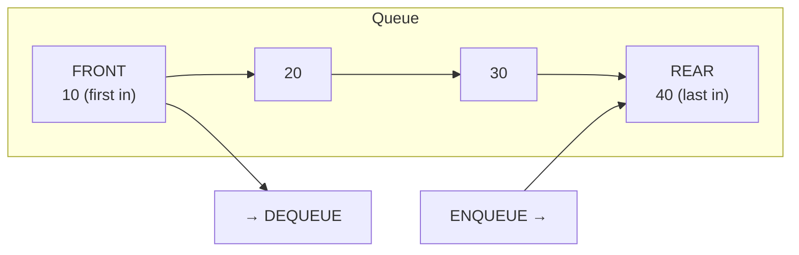
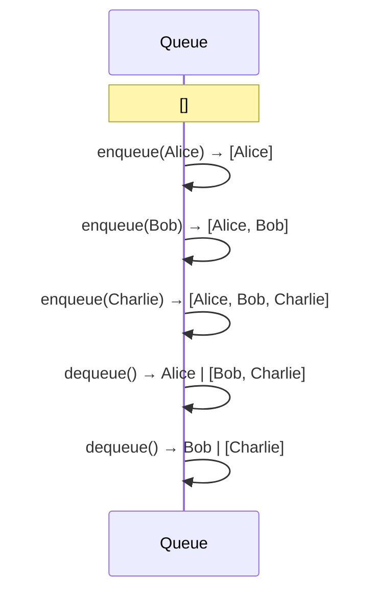
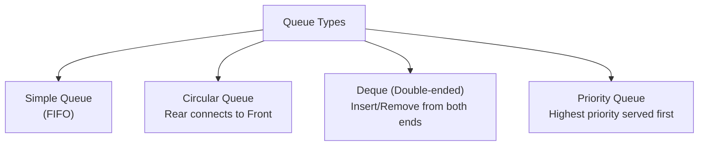

# Queues

---

## 1. What is a Queue?

A **Queue** is a linear data structure following **FIFO** — First In, First Out. Like a real-world queue/line — the first person to join is first to be served.



---

## 2. Core Operations

| Operation | Description | Time |
|---|---|---|
| **enqueue(x)** | Add element to rear | O(1) |
| **dequeue()** | Remove & return front element | O(1) |
| **peek()** / `front()` | View front without removing | O(1) |
| **is_empty()** | Check if queue is empty | O(1) |

---

## 3. Queue Using `collections.deque`

```python
from collections import deque

class Queue:
    def __init__(self):
        self._data = deque()

    def enqueue(self, item):
        self._data.append(item)          # Add to rear

    def dequeue(self):
        if self.is_empty():
            raise IndexError("Dequeue from empty queue")
        return self._data.popleft()      # Remove from front — O(1)

    def peek(self):
        return self._data[0]

    def is_empty(self):
        return len(self._data) == 0

    def size(self):
        return len(self._data)

q = Queue()
q.enqueue("Alice")
q.enqueue("Bob")
q.enqueue("Charlie")
print(q.peek())       # Alice
print(q.dequeue())    # Alice
print(q.dequeue())    # Bob
print(q.size())       # 1
```

**Output:**

```text
Alice
Alice
Bob
1
```

---

## 4. FIFO Flow Visualization



---

## 5. Queue Types



---

## 6. Priority Queue (using `heapq`)

```python
import heapq

pq = []
heapq.heappush(pq, (1, "low priority"))
heapq.heappush(pq, (10, "high priority"))
heapq.heappush(pq, (5, "medium priority"))

# Always pops the smallest (highest priority) first
while pq:
    priority, task = heapq.heappop(pq)
    print(f"Priority {priority}: {task}")
```

**Output:**

```text
Priority 1: low priority
Priority 5: medium priority
Priority 10: high priority
```

---

## 7. Real-World Applications

| Application | Queue Type |
|---|---|
| OS process scheduling | Priority Queue |
| Print spooler | Simple Queue |
| BFS graph traversal | Simple Queue |
| Call center routing | Priority Queue |
| Web server request handling | Simple Queue |

---

## 8. Stack vs Queue

| Feature | Stack (LIFO) | Queue (FIFO) |
|---|---|---|
| **Order** | Last in, first out | First in, first out |
| **Insert** | Push to top | Enqueue to rear |
| **Remove** | Pop from top | Dequeue from front |
| **Use Case** | Undo, DFS, recursion | BFS, scheduling, buffering |
