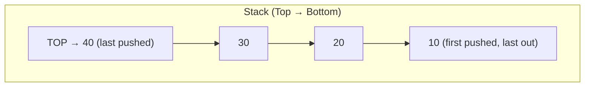
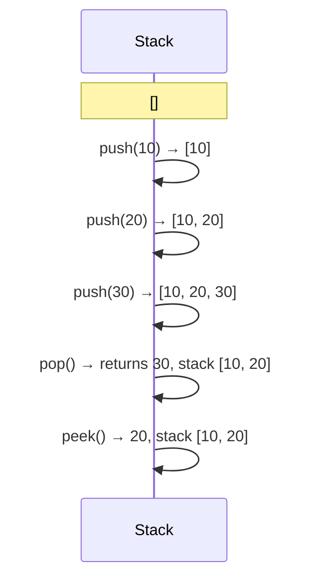
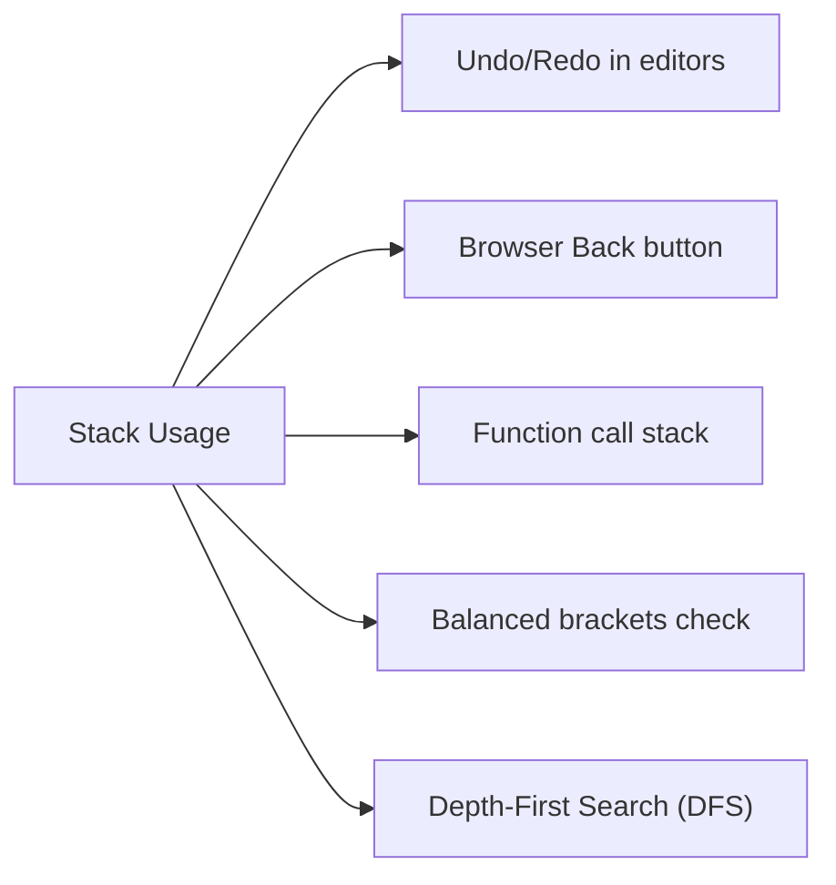

# Stacks

---

## 1. What is a Stack?

A **Stack** is a linear data structure following **LIFO** — Last In, First Out. The last element pushed is the first to be popped.



---

## 2. Core Operations

| Operation | Description | Time |
|---|---|---|
| **push(x)** | Add element to top | O(1) |
| **pop()** | Remove & return top element | O(1) |
| **peek()** | View top without removing | O(1) |
| **is_empty()** | Check if stack has no elements | O(1) |

---

## 3. Stack Using Python List

```python
class Stack:
    def __init__(self):
        self._data = []

    def push(self, item):
        self._data.append(item)      # Add to top

    def pop(self):
        if self.is_empty():
            raise IndexError("Pop from empty stack")
        return self._data.pop()      # Remove from top

    def peek(self):
        if self.is_empty():
            raise IndexError("Stack is empty")
        return self._data[-1]

    def is_empty(self):
        return len(self._data) == 0

    def size(self):
        return len(self._data)

# Demo
stack = Stack()
stack.push(10)
stack.push(20)
stack.push(30)
print(stack.peek())   # 30
print(stack.pop())    # 30
print(stack.pop())    # 20
print(stack.size())   # 1
```

**Output:**

```text
30
30
20
1
```

---

## 4. Push and Pop Visualization



---

## 5. Real-World Applications



---

## 6. Classic Problem: Balanced Parentheses

```python
def is_balanced(s: str) -> bool:
    stack = []
    pairs = {')': '(', '}': '{', ']': '['}

    for ch in s:
        if ch in "({[":
            stack.append(ch)          # Push opening bracket
        elif ch in ")}]":
            if not stack or stack[-1] != pairs[ch]:
                return False          # Mismatch!
            stack.pop()               # Matched — pop

    return len(stack) == 0            # Must be fully matched

print(is_balanced("({[]})"))    # True
print(is_balanced("({[})"))     # False
```

---

## 7. Using `collections.deque` (Preferred for Performance)

```python
from collections import deque

stack = deque()
stack.append(10)       # push
stack.append(20)
print(stack.pop())     # 20 — pop from right (top)
```

> `deque` is preferred over `list` for stacks requiring thread-safety or frequent operations.
