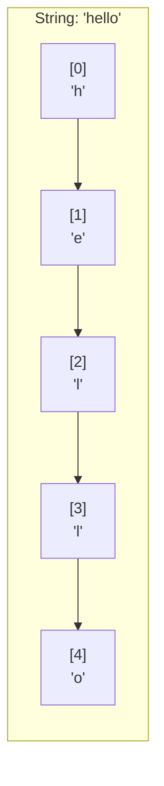
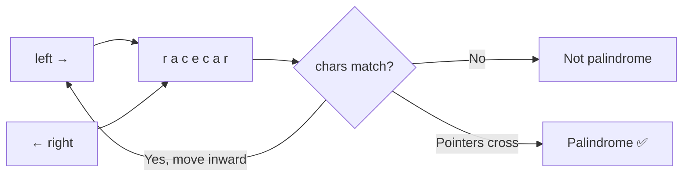

# Strings

---

## 1. What is a String?

A **string** is an immutable sequence of characters. Under the hood it behaves like a read-only array of characters.



---

## 2. Immutability

```python
s = "hello"
# s[0] = 'H'   # TypeError! Strings are immutable

# To "modify", create a new string
s = "H" + s[1:]
print(s)   # Hello
```

---

## 3. Common String Operations

```python
s = "Hello, World!"

print(len(s))           # 13 — O(1) in Python (cached)
print(s[0])             # H — O(1)
print(s.lower())        # hello, world!
print(s.upper())        # HELLO, WORLD!
print(s.strip())        # Removes leading/trailing whitespace
print(s.split(", "))    # ['Hello', 'World!']
print(s.replace("World", "Python"))  # Hello, Python!
print("World" in s)     # True — O(n)
print(s.startswith("Hello"))   # True
print(s[7:12])          # World — slicing O(k)
```

---

## 4. String Building — The Right Way

```python
# BAD — O(n²): Each + creates a new string object
result = ""
for char in "hello":
    result += char

# GOOD — O(n): join is optimized
parts = ["h", "e", "l", "l", "o"]
result = "".join(parts)
print(result)   # hello
```

---

## 5. String Reversal (Classic Interview Pattern)

```python
s = "algorithm"

# Method 1: Slicing
rev = s[::-1]

# Method 2: Two-pointer on list
chars = list(s)
left, right = 0, len(chars) - 1
while left < right:
    chars[left], chars[right] = chars[right], chars[left]
    left += 1
    right -= 1
rev2 = "".join(chars)

print(rev)    # mhtirogla
print(rev2)   # mhtirogla
```

---

## 6. Palindrome Check



```python
def is_palindrome(s: str) -> bool:
    s = s.lower().replace(" ", "")
    left, right = 0, len(s) - 1
    while left < right:
        if s[left] != s[right]:
            return False
        left += 1
        right -= 1
    return True

print(is_palindrome("racecar"))   # True
print(is_palindrome("hello"))     # False
```

---

## 7. Complexity of Common Operations

| Operation | Time Complexity |
|---|---|
| `len(s)` | O(1) |
| `s[i]` index access | O(1) |
| `s + t` concatenation | O(n + m) |
| `"".join(list)` | O(n) |
| `s.find(sub)` | O(n·m) naive |
| `s.split()` | O(n) |
| `s[::-1]` reverse | O(n) |

---

## 8. Useful String Methods Quick Reference

```python
"  hello  ".strip()          # "hello"
"hello world".title()        # "Hello World"
"abcabc".count("a")          # 2
"hello".index("l")           # 2 (first occurrence)
"42".isdigit()               # True
"abc".isalpha()              # True
"-".join(["a", "b", "c"])    # "a-b-c"
```
