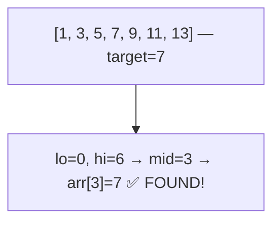
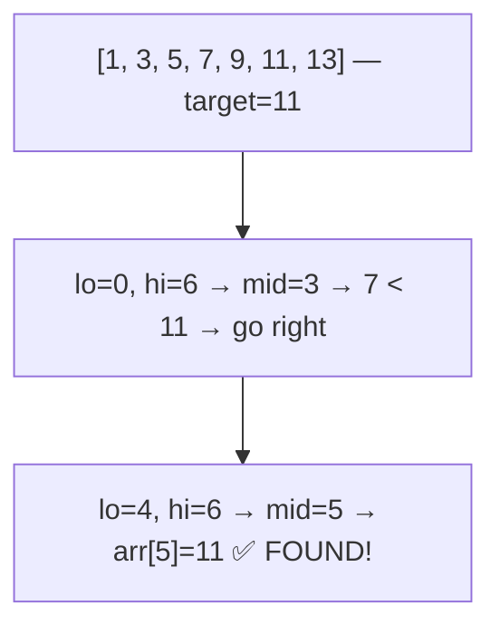
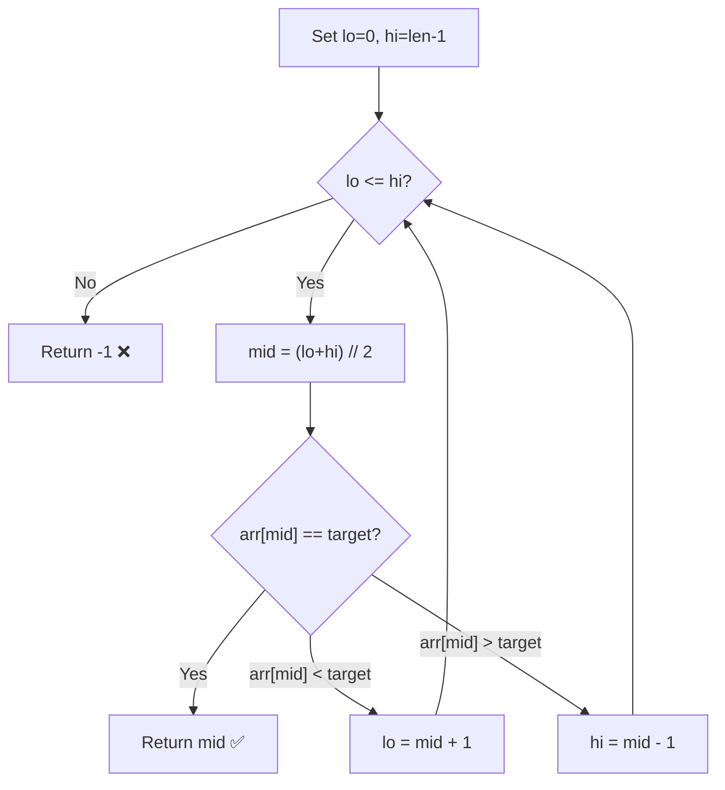

# Binary Search

---

## 1. What is Binary Search?

**Binary Search** works on **sorted arrays** by repeatedly halving the search range. It eliminates half the remaining elements with every comparison.

> "Open to the middle of a dictionary. Word before middle? Discard right half. After? Discard left half. Repeat."

---

## 2. Algorithm Visualization





---

## 3. How It Works (Flowchart)



---

## 4. Iterative Implementation

```python
def binary_search(arr: list, target) -> int:
    lo, hi = 0, len(arr) - 1

    while lo <= hi:
        mid = (lo + hi) // 2

        if arr[mid] == target:
            return mid              # Found!
        elif arr[mid] < target:
            lo = mid + 1            # Search right half
        else:
            hi = mid - 1            # Search left half

    return -1                       # Not found

arr = [1, 3, 5, 7, 9, 11, 13]
print(binary_search(arr, 7))    # 3
print(binary_search(arr, 6))    # -1
```

**Output:**

```text
3
-1
```

---

## 5. Recursive Implementation

```python
def binary_search_recursive(arr, target, lo=0, hi=None):
    if hi is None: hi = len(arr) - 1
    if lo > hi: return -1

    mid = (lo + hi) // 2
    if arr[mid] == target:
        return mid
    elif arr[mid] < target:
        return binary_search_recursive(arr, target, mid + 1, hi)
    else:
        return binary_search_recursive(arr, target, lo, mid - 1)
```

---

## 6. Step-by-Step Trace

Target = **9** in `[1, 3, 5, 7, 9, 11, 13]`

| Step | lo | hi | mid | arr[mid] | Action |
|---|---|---|---|---|---|
| 1 | 0 | 6 | 3 | 7 | 7 < 9 → lo = 4 |
| 2 | 4 | 6 | 5 | 11 | 11 > 9 → hi = 4 |
| 3 | 4 | 4 | 4 | 9 | **Found! Return 4** |

---

## 7. Complexity Analysis

| Case | Complexity |
|---|---|
| **Best** | O(1) — target is mid |
| **Average / Worst** | O(log n) |
| **Space (iterative)** | O(1) |
| **Space (recursive)** | O(log n) — call stack |

---

## 8. Linear vs Binary Search

| Feature | Linear Search | Binary Search |
|---|---|---|
| **Requires sorted data** | No | Yes |
| **Time Complexity** | O(n) | O(log n) |
| **For n=1,000,000** | 1,000,000 steps | ~20 steps |
