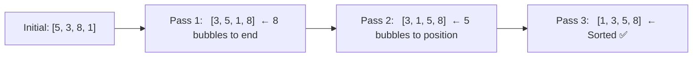
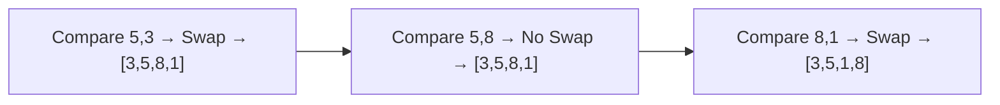
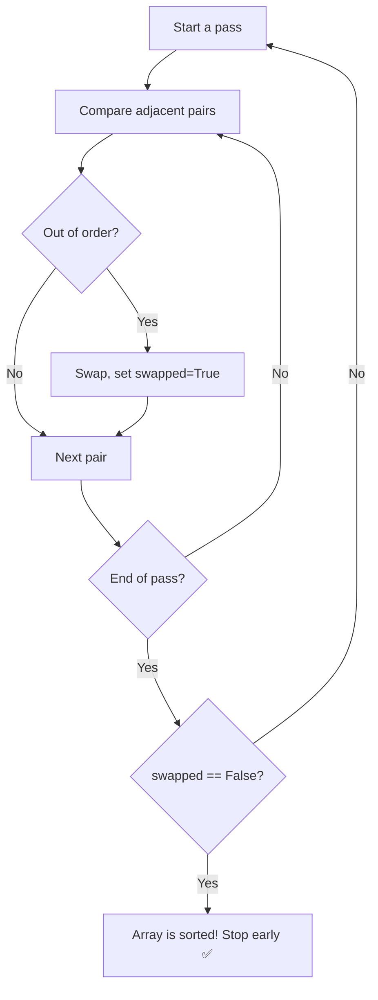

# Bubble Sort

---

## 1. What is Bubble Sort?

**Bubble Sort** repeatedly compares adjacent elements and swaps them if out of order. After each pass, the largest unsorted element "bubbles up" to its correct position.

---

## 2. Visual Pass-by-Pass

Sorting `[5, 3, 8, 1]`:



---

## 3. Single Pass Walkthrough

Pass on `[5, 3, 8, 1]`:



---

## 4. Implementation

```python
def bubble_sort(arr: list) -> list:
    n = len(arr)
    arr = arr.copy()   # Don't mutate original

    for i in range(n):
        swapped = False
        for j in range(0, n - i - 1):    # Last i elements already sorted
            if arr[j] > arr[j + 1]:
                arr[j], arr[j + 1] = arr[j + 1], arr[j]
                swapped = True

        if not swapped:
            break    # Optimization: stop if no swaps in this pass

    return arr

arr = [64, 34, 25, 12, 22, 11, 90]
print(bubble_sort(arr))
```

**Output:**

```text
[11, 12, 22, 25, 34, 64, 90]
```

---

## 5. The `swapped` Optimization



---

## 6. Complexity Analysis

| Case | Comparisons | Time | Trigger |
|---|---|---|---|
| **Best** | n-1 | O(n) | Already sorted (swapped optimization) |
| **Average** | n²/2 | O(n²) | Random order |
| **Worst** | n²/2 | O(n²) | Reverse sorted |
| **Space** | — | O(1) | In-place sorting |

---

## 7. Properties

| Property | Value |
|---|---|
| **Stable?** | ✅ Yes — equal elements maintain relative order |
| **In-place?** | ✅ Yes — no extra array needed |
| **Adaptive?** | ✅ Yes — with swapped optimization |
| **Best for?** | Small or nearly-sorted datasets |
| **Worst for?** | Large datasets — O(n²) is too slow |
