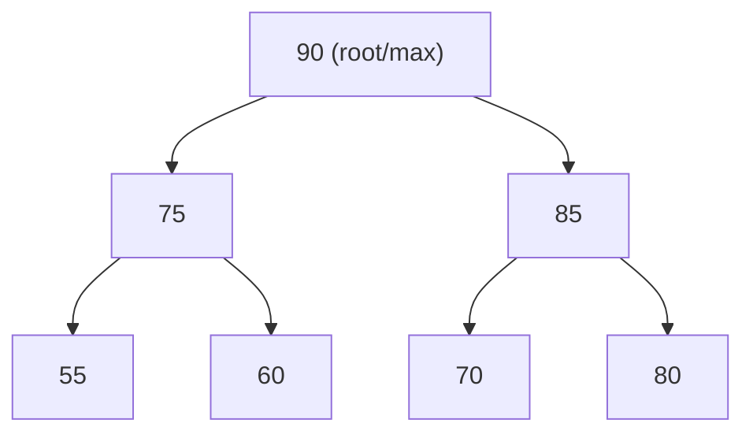
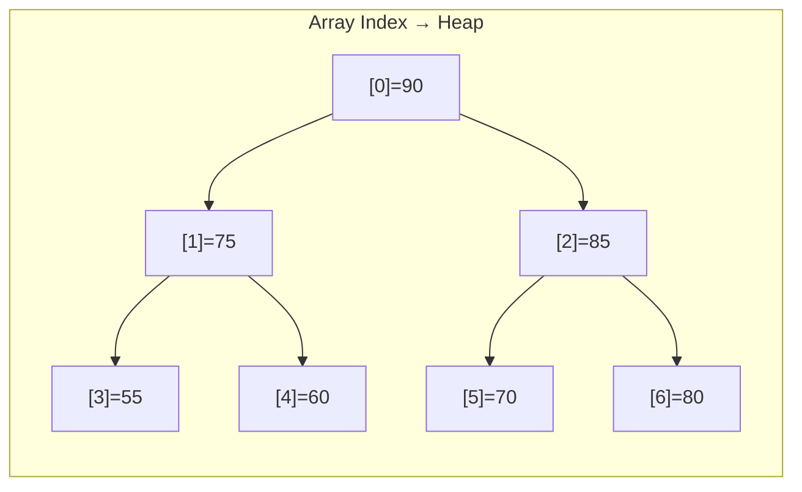
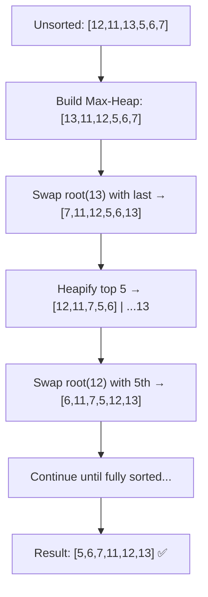

# Heap Sort

---

## 1. What is Heap Sort?

**Heap Sort** uses a **Max-Heap** data structure to sort an array in-place. It works in two phases:
1. **Build a Max-Heap** from the array
2. **Extract the maximum** repeatedly to produce sorted order

---

## 2. What is a Heap?

A **Max-Heap** is a complete binary tree where every parent node is **greater than or equal to** its children.



> In an array representation: Parent at `i`, Left child at `2i+1`, Right child at `2i+2`.

---

## 3. Array Representation of Heap



---

## 4. The Heapify Operation

**Heapify** restores the heap property at a node by swapping it with the largest child and recursing down:

```mermaid
flowchart TD
    Node["Node at index i"]
    Find["Find largest among: arr[i], arr[2i+1], arr[2i+2]"]
    Check{Largest == arr[i]?}
    Check -->|Yes| Done["Heap property satisfied"]
    Check -->|No| Swap["Swap arr[i] with arr[largest]"]
    Swap --> Recurse["Heapify at largest index"]
    Node --> Find --> Check
```

---

## 5. Implementation

```python
def heap_sort(arr: list) -> list:
    arr = arr.copy()
    n = len(arr)

    # Phase 1: Build Max-Heap (from bottom-up)
    for i in range(n // 2 - 1, -1, -1):
        heapify(arr, n, i)

    # Phase 2: Extract elements one by one
    for i in range(n - 1, 0, -1):
        arr[0], arr[i] = arr[i], arr[0]   # Move max to end
        heapify(arr, i, 0)                # Restore heap for reduced size

    return arr

def heapify(arr, heap_size, root):
    largest = root
    left = 2 * root + 1
    right = 2 * root + 2

    if left < heap_size and arr[left] > arr[largest]:
        largest = left
    if right < heap_size and arr[right] > arr[largest]:
        largest = right

    if largest != root:
        arr[root], arr[largest] = arr[largest], arr[root]
        heapify(arr, heap_size, largest)   # Fix the affected subtree

arr = [12, 11, 13, 5, 6, 7]
print(heap_sort(arr))
```

**Output:**

```text
[5, 6, 7, 11, 12, 13]
```

---

## 6. Heap Sort Process Visualization



---

## 7. Complexity Analysis

| Case | Time | Space |
|---|---|---|
| **Best** | O(n log n) | O(1) |
| **Average** | O(n log n) | O(1) |
| **Worst** | O(n log n) | O(1) |

> Heap Sort guarantees **O(n log n)** in all cases with **O(1)** extra space — unique combination.

---

## 8. Sorting Algorithm Final Comparison

| Algorithm | Best | Average | Worst | Space | Stable |
|---|---|---|---|---|---|
| **Bubble Sort** | O(n) | O(n²) | O(n²) | O(1) | ✅ |
| **Selection Sort** | O(n²) | O(n²) | O(n²) | O(1) | ❌ |
| **Insertion Sort** | O(n) | O(n²) | O(n²) | O(1) | ✅ |
| **Merge Sort** | O(n log n) | O(n log n) | O(n log n) | O(n) | ✅ |
| **Quick Sort** | O(n log n) | O(n log n) | O(n²) | O(log n) | ❌ |
| **Heap Sort** | O(n log n) | O(n log n) | O(n log n) | O(1) | ❌ |
