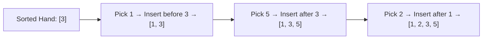
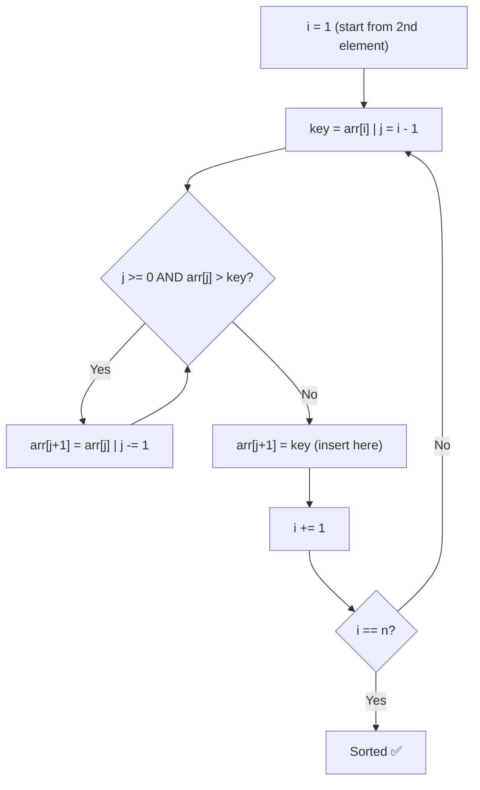
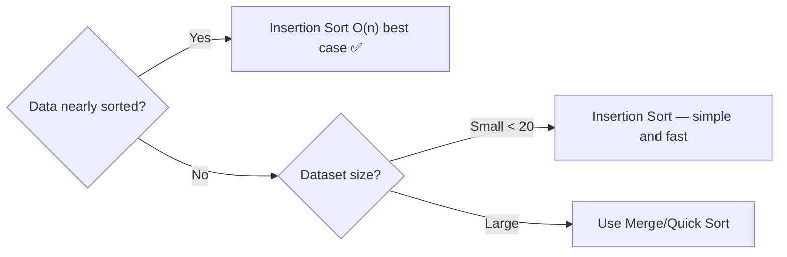

# Insertion Sort

---

## 1. What is Insertion Sort?

**Insertion Sort** builds the sorted array one element at a time by picking each new element and inserting it into the correct position in the already-sorted portion — just like sorting cards in your hand.



---

## 2. Algorithm Walkthrough

For each element (key), shift larger sorted elements right to make room:



---

## 3. Implementation

```python
def insertion_sort(arr: list) -> list:
    arr = arr.copy()
    for i in range(1, len(arr)):
        key = arr[i]           # Element to be placed
        j = i - 1

        # Shift elements greater than key to the right
        while j >= 0 and arr[j] > key:
            arr[j + 1] = arr[j]
            j -= 1

        arr[j + 1] = key       # Insert key in correct position

    return arr

arr = [12, 11, 13, 5, 6]
print(insertion_sort(arr))
```

**Output:**

```text
[5, 6, 11, 12, 13]
```

---

## 4. Trace: `[12, 11, 13, 5, 6]`

| Pass | Key | Action | Array State |
|---|---|---|---|
| i=1 | 11 | 12 > 11 → shift right | [**11, 12**, 13, 5, 6] |
| i=2 | 13 | 12 < 13 → no shift | [11, 12, **13**, 5, 6] |
| i=3 | 5 | Shift 13,12,11 right | [**5**, 11, 12, 13, 6] |
| i=4 | 6 | Shift 13,12,11 right | [5, **6**, 11, 12, 13] |

---

## 5. Complexity Analysis

| Case | Condition | Time |
|---|---|---|
| **Best** | Already sorted — no shifts needed | O(n) |
| **Average** | Random order | O(n²) |
| **Worst** | Reverse sorted — maximum shifts | O(n²) |
| **Space** | In-place | O(1) |

---

## 6. Properties

| Property | Value |
|---|---|
| **Stable?** | ✅ Yes |
| **In-place?** | ✅ Yes |
| **Adaptive?** | ✅ Yes — fast on nearly-sorted data |
| **Online?** | ✅ Yes — can sort as elements arrive |

---

## 7. When to Use Insertion Sort



> Python's built-in `sorted()` uses **Timsort** which switches to Insertion Sort for small subarrays.
