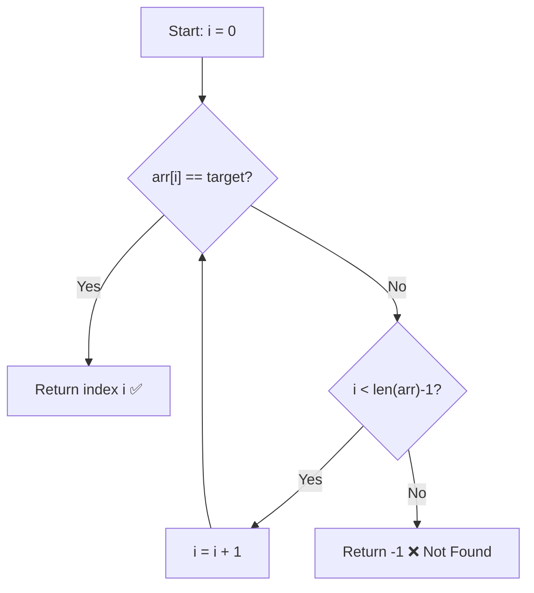
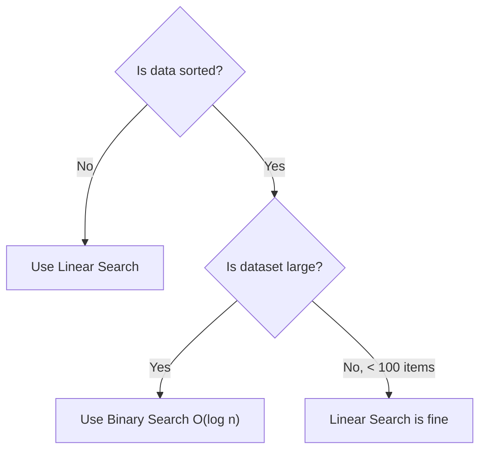

# Linear Search

---

## 1. What is Linear Search?

**Linear Search** scans each element one by one from start to end until the target is found or the array is exhausted.


---

## 2. Algorithm Walkthrough



---

## 3. Implementation

```python
def linear_search(arr: list, target) -> int:
    for i, val in enumerate(arr):
        if val == target:
            return i       # Found at index i
    return -1              # Not found

# Demo
arr = [5, 3, 8, 1, 9, 2]
print(linear_search(arr, 9))    # 4
print(linear_search(arr, 7))    # -1
```

**Output:**

```text
4
-1
```

---

## 4. Step-by-Step Trace

Target = **8** in `[5, 3, 8, 1, 9]`

| Step | Index | Value | Match? |
|---|---|---|---|
| 1 | 0 | 5 | No |
| 2 | 1 | 3 | No |
| 3 | 2 | 8 | **Yes → return 2** |

---

## 5. Finding All Occurrences

```python
def find_all(arr: list, target) -> list:
    return [i for i, val in enumerate(arr) if val == target]

arr = [1, 3, 2, 3, 5, 3]
print(find_all(arr, 3))   # [1, 3, 5]
```

---

## 6. Complexity Analysis

| Case | Condition | Complexity |
|---|---|---|
| **Best** | Target is at index 0 | O(1) |
| **Average** | Target is in the middle | O(n/2) → O(n) |
| **Worst** | Target not in list | O(n) |
| **Space** | No extra memory | O(1) |

---

## 7. When to Use Linear Search



| Scenario | Suitable? |
|---|---|
| Unsorted data | ✅ Yes |
| Sorted data, large | ❌ Use Binary Search |
| Linked lists (no random access) | ✅ Yes |
| Small datasets | ✅ Yes |
