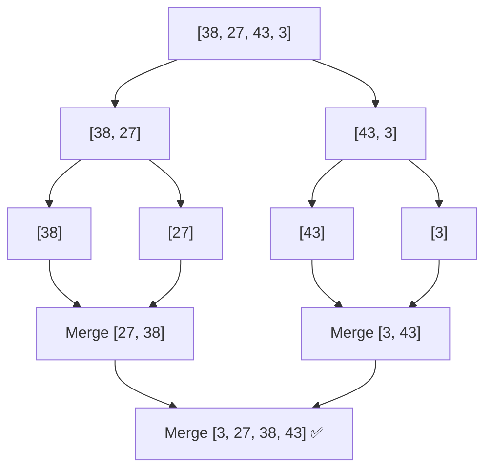
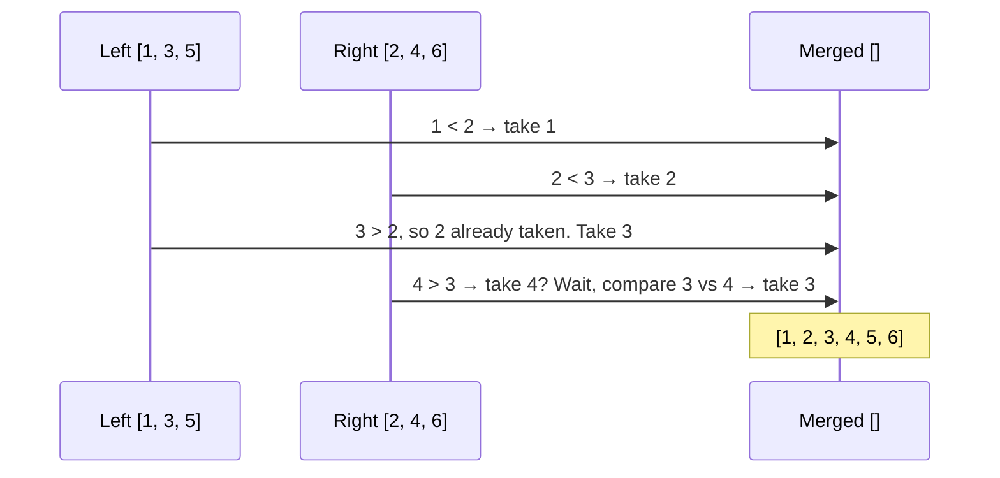

# Merge Sort

---

## 1. What is Merge Sort?

**Merge Sort** is a **divide-and-conquer** algorithm. It recursively splits the array in half, sorts each half, then **merges** them back in order.

> "Split a pile of cards into two, sort each pile, then merge them in order."

---

## 2. Divide and Conquer Visualization



---

## 3. Merge Step (Core Logic)

The merge step combines two sorted halves into one sorted array:



---

## 4. Implementation

```python
def merge_sort(arr: list) -> list:
    if len(arr) <= 1:
        return arr          # Base case: single element is sorted

    mid = len(arr) // 2
    left = merge_sort(arr[:mid])      # Sort left half
    right = merge_sort(arr[mid:])     # Sort right half
    return merge(left, right)         # Merge sorted halves

def merge(left: list, right: list) -> list:
    result = []
    i = j = 0

    while i < len(left) and j < len(right):
        if left[i] <= right[j]:
            result.append(left[i])
            i += 1
        else:
            result.append(right[j])
            j += 1

    result.extend(left[i:])     # Append remaining elements
    result.extend(right[j:])
    return result

arr = [38, 27, 43, 3, 9, 82, 10]
print(merge_sort(arr))
```

**Output:**

```text
[3, 9, 10, 27, 38, 43, 82]
```

---

## 5. Complexity Analysis

| Case | Time | Space | Notes |
|---|---|---|---|
| **Best** | O(n log n) | O(n) | Always splits evenly |
| **Average** | O(n log n) | O(n) | Consistent performance |
| **Worst** | O(n log n) | O(n) | No worst-case degradation |

**Why O(n log n)?**
- **log n** levels of splitting (halving until size=1)
- **O(n)** merge work at each level
- Total: n × log n

---

## 6. Properties

| Property | Value |
|---|---|
| **Stable?** | ✅ Yes — equal elements keep relative order |
| **In-place?** | ❌ No — requires O(n) auxiliary space |
| **Predictable?** | ✅ Yes — always O(n log n) |
| **Best for?** | Large datasets, linked lists, external sorting |

---

## 7. Merge Sort vs Quick Sort

| Feature | Merge Sort | Quick Sort |
|---|---|---|
| **Worst Case** | O(n log n) | O(n²) |
| **Average Case** | O(n log n) | O(n log n) |
| **Space** | O(n) | O(log n) |
| **Stable?** | ✅ Yes | ❌ No |
| **Cache Performance** | Moderate | Better |
