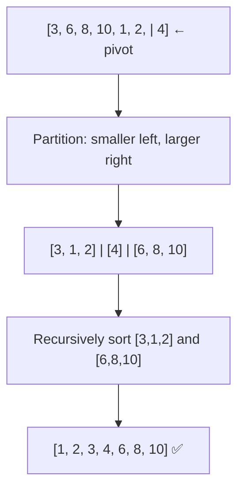
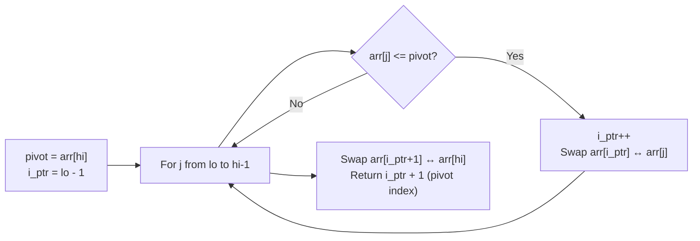
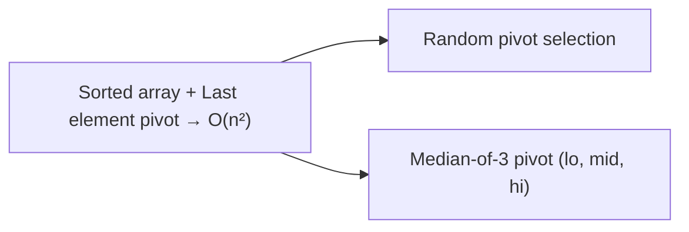

# Quick Sort

---

## 1. What is Quick Sort?

**Quick Sort** picks a **pivot** element, partitions the array so all smaller elements are to its left and larger to its right, then recursively sorts both sides.

> "Pick a reference point, divide the group into smaller and larger, sort each group."

---

## 2. Partitioning Visualization

Pivot = last element `4` from `[3, 6, 8, 10, 1, 2, 4]`:



---

## 3. Partition Step (Lomuto Scheme)



---

## 4. Implementation

```python
def quick_sort(arr: list, lo: int = 0, hi: int = None) -> list:
    if hi is None:
        arr = arr.copy()
        hi = len(arr) - 1

    if lo < hi:
        pivot_idx = partition(arr, lo, hi)
        quick_sort(arr, lo, pivot_idx - 1)      # Sort left of pivot
        quick_sort(arr, pivot_idx + 1, hi)      # Sort right of pivot

    return arr

def partition(arr, lo, hi):
    pivot = arr[hi]       # Choose last element as pivot
    i = lo - 1            # Pointer for smaller elements

    for j in range(lo, hi):
        if arr[j] <= pivot:
            i += 1
            arr[i], arr[j] = arr[j], arr[i]   # Swap smaller to left

    arr[i + 1], arr[hi] = arr[hi], arr[i + 1] # Place pivot correctly
    return i + 1

arr = [10, 7, 8, 9, 1, 5]
print(quick_sort(arr))
```

**Output:**

```text
[1, 5, 7, 8, 9, 10]
```

---

## 5. Trace: Pivot Placement

Array `[3, 1, 2]`, pivot = `2`:

| j | arr[j] | arr[j] <= 2? | Action |
|---|---|---|---|
| 0 | 3 | No | Skip |
| 1 | 1 | Yes | i=0, swap arr[0]↔arr[1] → [1,3,2] |
| — | — | End | Swap arr[i+1]↔pivot → [**1,2,3**] |

---

## 6. Complexity Analysis

| Case | Condition | Time | Space |
|---|---|---|---|
| **Best** | Pivot always splits evenly | O(n log n) | O(log n) |
| **Average** | Random data | O(n log n) | O(log n) |
| **Worst** | Already sorted + bad pivot choice | O(n²) | O(n) |

---

## 7. Avoiding Worst Case



```python
import random
def partition_random(arr, lo, hi):
    rand_idx = random.randint(lo, hi)
    arr[rand_idx], arr[hi] = arr[hi], arr[rand_idx]  # Swap random to end
    return partition(arr, lo, hi)
```

---

## 8. Properties

| Property | Value |
|---|---|
| **Stable?** | ❌ No |
| **In-place?** | ✅ Yes — O(log n) stack space |
| **Cache Performance** | ✅ Excellent — sequential access |
| **Best for?** | General-purpose sorting, large arrays |
