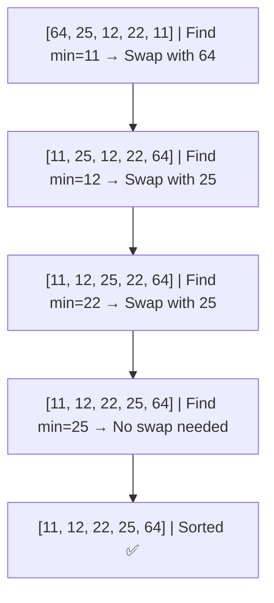
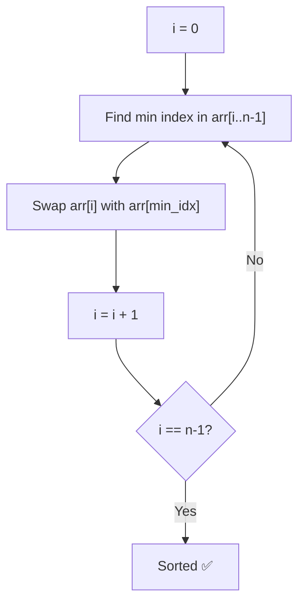

# Selection Sort

---

## 1. What is Selection Sort?

**Selection Sort** divides the array into sorted and unsorted regions. In each pass, it **selects the minimum** element from the unsorted region and places it at the boundary.

> "Find the smallest card from the unsorted pile and place it at the end of the sorted pile."

---

## 2. Visual Walkthrough

Sorting `[64, 25, 12, 22, 11]`:



---

## 3. How It Works (Flowchart)



---

## 4. Implementation

```python
def selection_sort(arr: list) -> list:
    arr = arr.copy()
    n = len(arr)

    for i in range(n - 1):
        # Find index of minimum in unsorted region arr[i..n-1]
        min_idx = i
        for j in range(i + 1, n):
            if arr[j] < arr[min_idx]:
                min_idx = j

        # Swap minimum into sorted position
        if min_idx != i:
            arr[i], arr[min_idx] = arr[min_idx], arr[i]

    return arr

arr = [64, 25, 12, 22, 11]
print(selection_sort(arr))
```

**Output:**

```text
[11, 12, 22, 25, 64]
```

---

## 5. Step-by-Step Trace

| Pass | i | Unsorted Region | Min Found | Array After Swap |
|---|---|---|---|---|
| 1 | 0 | [64,25,12,22,11] | 11 at idx 4 | [**11**,25,12,22,64] |
| 2 | 1 | [25,12,22,64] | 12 at idx 2 | [11,**12**,25,22,64] |
| 3 | 2 | [25,22,64] | 22 at idx 3 | [11,12,**22**,25,64] |
| 4 | 3 | [25,64] | 25 at idx 3 | [11,12,22,**25**,64] |

---

## 6. Complexity Analysis

| Case | Time | Note |
|---|---|---|
| **Best** | O(n²) | Always scans full unsorted region |
| **Average** | O(n²) | n(n-1)/2 comparisons |
| **Worst** | O(n²) | Same regardless of input order |
| **Space** | O(1) | In-place |

> Selection Sort makes at most **n-1 swaps** — useful when write operations are expensive.

---

## 7. Properties

| Property | Value |
|---|---|
| **Stable?** | ❌ No (standard version) |
| **In-place?** | ✅ Yes |
| **Swaps** | O(n) — minimum among O(n²) algorithms |
| **Best for?** | When minimizing swaps matters (e.g., write-heavy flash memory) |
